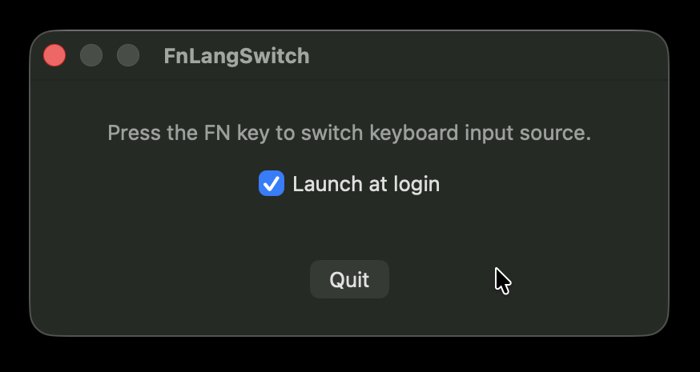

## Problem

macOS uses FN/Globe key to show an input source picker popup, which is slow and distracting. FnLangSwitch replaces that with a direct, instant toggle between your keyboard layouts.

## Solution

A minimal macOS app that switches your keyboard input source (language) when you press the **FN** key. No popups, no delays — instant, invisible switching. The app runs in the background with no dock icon and no menu bar icon.

 

## Download

Download the latest version from [GitHub Releases](https://github.com/tonku321/fn-lang-switcher/releases/latest).

## Usage

1. Go to **System Settings > Keyboard** and set **"Press globe key to"** to **"Do Nothing"**. This prevents macOS from showing its own input source picker when you press FN.
2. Launch the app and allow it in **System Settings > Privacy & Security > Input Monitoring**, then quit and relaunch it. Rebuilding or changing the app signature may require granting this permission again.
3. Leave **Keyboard Shortcuts > Modifier Keys > Globe/Fn** mapped to Globe/Fn; changing that separate setting to **No Action** also disables Fn combinations.
4. Press **FN** to toggle between your input sources. With **switch on release** enabled, a short tap switches; a long hold or a combination with another key does not. Switching on press intentionally changes the layout before any later key can turn the press into a combination.

## How it works

- Reads hardware FN/Globe press and release values through IOKit HID, so switching does not depend on macOS including the Fn modifier flag in an event.
- Uses temporary keyboard pressed-state information to cancel Fn combinations. It does not decode or record typed text.
- Keeps per-device Fn state so duplicate values and overlapping keyboard presses do not switch twice.
- Writes bounded diagnostic logs to `~/Library/Logs/FnLangSwitch/diagnostics.log`: permission and HID startup results, Fn transitions, cancellation, and input-source selection results. Logs do not contain typed text or ordinary key codes.
- Switches input sources using the Carbon `TISSelectInputSource` API
