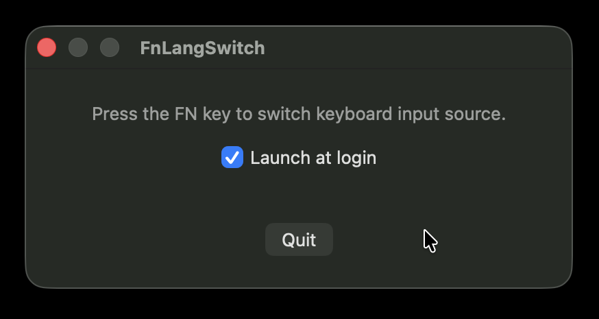

## Problem

macOS uses FN/Globe key to show an input source picker popup, which is slow and distracting. FnLangSwitch replaces that with a direct, instant toggle between your keyboard layouts.

## Solution



A minimal macOS app that switches your keyboard input source (language) when you press the **FN** key. No popups, no delays — instant, invisible switching. The app runs in the background with no dock icon and no menu bar icon.

<br clear="left">

## How this fork differs from the original

This fork of [tonku321/fn-lang-switcher](https://github.com/tonku321/fn-lang-switcher)
was created to address the failure documented in
[upstream PR #16](https://github.com/tonku321/fn-lang-switcher/pull/16): on the
reported Mac running **macOS 27.0.1**, Fn events arrived with key code 63 but
without the `.function` modifier flag. The original handler therefore never
requested a layout change. This was observed with both the built-in and an
external keyboard. Reading Fn directly through HID restored switching on that
setup.

This is a workaround for the reported setup, not a claim that the original
fails on every Mac. The PR also reports a working original installation on
the same macOS version. HID requires Input Monitoring permission; whether
that permission alone would fix the original NSEvent implementation was not
tested. See the PR for validation details and limitations.

The comparison below is against the upstream source imported at commit `f9cdef5`.

- **Hardware Fn detection.** The original reads the `.function` modifier flag
  from macOS events. This fork reads Fn/Globe press and release values through
  IOKit HID, so detection does not depend on that flag being present.
- **More explicit combination handling.** The fork tracks already-held keyboard
  keys, blocking modifiers and Secure Input, and keeps Fn state per device.
  Duplicate Fn values are ignored; overlapping Fn presses cancel a release-mode tap.
- **Diagnostic logs.** Bounded, rotating logs record HID access, Fn transitions,
  cancellation reasons, input-source selection and verification, and state at
  sleep/wake and session transitions. Typed text, ordinary key codes and device
  identifiers are not logged.
- **Recovery instructions.** [docs/OPERATIONS.md](docs/OPERATIONS.md) records
  installation checks and the verified Input Monitoring recovery procedure.

Switch-on-press, the optional switch-on-release mode, the 400 ms tap limit and
launch-at-login support already existed in the original. They are not new fork
features. HID access requires **Input Monitoring** permission.

Separately, the later intermittent failure reported on the local installation remains under
investigation. Diagnostics v2 adds evidence for the next occurrence; it does
not claim to fix its unknown cause or automatically repair permissions.

## Download

The [upstream releases](https://github.com/tonku321/fn-lang-switcher/releases/latest)
contain the original application, not this fork's HID and diagnostic changes.
To build this fork from source, run `./build-app.sh`; it creates
`.build/FnLangSwitch.app`. The separately installed local Diagnostics bundle is
documented in [docs/OPERATIONS.md](docs/OPERATIONS.md).

## Setup and usage

1. In **System Settings > Keyboard**, set **"Press globe key to"** to
   **"Do Nothing"** to disable the system input-source picker.
2. In **Keyboard > Keyboard Shortcuts > Modifier Keys**, leave **Globe/Fn**
   mapped to **Globe/Fn**. These are two separate settings: **Do Nothing** in
   step 1 disables the picker; **No Action** here also disables Fn combinations.
3. Launch the app you built or installed. In **System Settings > Privacy &
   Security > Input Monitoring**, allow that exact app, then quit and relaunch
   it (or use **Quit & Reopen** when offered).
4. In the app's settings, enable **"Switch on Fn release (ignores Fn+key
   combos)"** if you want Fn combinations to preserve the current layout.
   A standalone tap shorter than 400 ms switches on release; a long hold or
   combination cancels the switch. With this option off, switching happens
   immediately on press, before a later key can form a combination.
5. Optionally enable **"Launch at login"** in the app's settings. Launch the
   same app again to reopen its settings; closing the window leaves it running
   in the background. Use **Quit** to stop it.
6. Test two short physical Fn taps with a pause between them, then test a
   combination such as **Fn+Delete** with switch-on-release enabled. Plain taps
   should change the layout; the combination should preserve it.

### Enabling diagnostics

**Diagnostics are always enabled in this fork's source.** There is no separate
diagnostics checkbox or command-line flag. Launching a build from this source
starts logging automatically to `~/Library/Logs/FnLangSwitch/diagnostics.log`.
For diagnostics v2, look for `diagnosticsVersion=2` in the latest
`monitor.start` entry. Check `hid.open result=0 inputMonitoring=true` and then
test physical Fn taps to confirm switching actually works.

### What was done on the author's Mac

**Confirmed local configuration and recovery, 2 November 2026:**

- **The original application did not switch layouts on the reported setup;
  the working application was the modified FnLangSwitch Diagnostics build.**
  That build combines HID-based Fn handling with automatic diagnostic logging.
  Logging itself was not tested as the cause of restored switching: the
  implementation and its permissions also differed from the original.
- The separately installed app is **FnLangSwitch Diagnostics**, with bundle ID
  `local.mydot.FnLangSwitchDiagnostics`. Its exact installed path is recorded in
  [docs/OPERATIONS.md](docs/OPERATIONS.md); it is different from the bundle
  produced by `build-app.sh`.
  To start the already installed, tested build on this Mac:

  ```sh
  open "/Users/filimo/MyProjects/MyDot/.local/fn-lang-switcher-diagnostics/.build/diagnostic/FnLangSwitch Diagnostics.app"
  ```

  This opens the existing local installation; it does not build or install
  changes from this repository. Use this exact app when granting Input
  Monitoring to that installation.
- **Switch on Fn release was enabled** (`switchOnRelease = 1`, read from the
  local preferences). Launch-at-login status was not verified. The two macOS
  keyboard settings above are setup instructions; their current UI values
  were not independently checked during this review.
- After the signed app was replaced, Input Monitoring looked enabled, but
  the app could not open HID: `hid.open result=-536870174 inputMonitoring=false`.
  Restarting and toggling the existing permission off/on did not help.
- **The working recovery was to remove only FnLangSwitch Diagnostics from
  Input Monitoring, add the exact current app again using the plus button,
  and apply Quit & Reopen.** This was done with the user's explicit approval.
  The backup app was not selected. No Mac reboot was needed for this recovery.
- The log then showed **`hid.open result=0 inputMonitoring=true`**. Physical
  Fn taps switched layouts, selection and current-layout checks succeeded,
  and the user confirmed that switching worked.

If access breaks after a rebuild or signature change, follow the full
[recovery procedure](docs/OPERATIONS.md) in the operations journal's
**«Если мониторинг ввода включён в настройках, но не
работает»** section. Check actual HID access and physical Fn behavior; an
enabled permission switch alone is not proof. This permission recovery is
separate from the intermittent switching failure still under investigation.

## How it works

- Reads hardware FN/Globe press and release values through IOKit HID, so switching does not depend on macOS including the Fn modifier flag in an event.
- Uses temporary keyboard pressed-state information to cancel Fn combinations. It does not decode or record typed text.
- Keeps per-device Fn state so duplicate values and overlapping keyboard presses do not switch twice.
- Writes bounded diagnostic logs to `~/Library/Logs/FnLangSwitch/diagnostics.log`: permission and HID startup results, Fn transitions, cancellation, and input-source selection results. Logs do not contain typed text or ordinary key codes.
- Switches input sources using the Carbon `TISSelectInputSource` API

### Diagnostic log v2

Each Fn press/release records cancellation reasons, the number of held keys and Fn devices,
the age of the last ordinary-key HID event (`-1` means none observed), blocking modifier names,
and Secure Input state. Reasons retained from press to release distinguish an already-held key,
modifiers, Secure Input, a later hardware chord, other event types, and overlapping Fn devices.
`outcome=longHold` identifies the existing 400 ms duration limit separately from cancellation.
Sleep/wake and session transitions record snapshots without changing keyboard state.
No typed text, ordinary key codes, key identities, or device identifiers are written to the log.
Switching behavior is unchanged.

### Журнал работ и восстановление

См. [docs/OPERATIONS.md](docs/OPERATIONS.md): история изменений и сбоев,
проверка установки, восстановление мониторинга ввода после обновления подписи.
Этот журнал нужно обновлять после следующих изменений и разборов сбоев.
